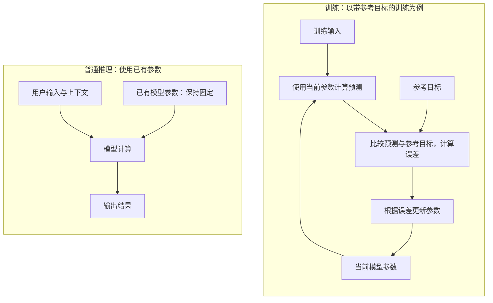

# B001 — 什么是大模型推理

## 知识讲解

**预计学习时间：20 分钟**

本课先分清“训练”和“推理”，再逐步理解模型如何生成回答。

**核心问题：模型收到问题并回答时，到底在做什么？**

先想象一个学过翻译的人：练习时，他根据纠错调整自己的方法；实际翻译时，他使用已经学到的方法处理新句子。模型也有类似的两个阶段：**训练形成能力，推理使用能力。**

这里的“推理”（Inference）指使用模型处理输入、计算输出的过程。翻译一句话、概括一段文字，都可以是推理，不一定涉及复杂的逻辑论证。

**从直觉走到原理**

模型内部有大量控制计算的数值，叫作**参数**，其中常见的一类叫**权重**。本课可以先把它们理解成许多可调旋钮。

训练时，程序让模型做预测，衡量预测与目标之间的差距，再调整这些旋钮。反复调整后，模型处理类似任务的能力可能改善。[PyTorch 训练教程](https://docs.pytorch.org/tutorials/beginner/basics/optimization_tutorial.html)

普通推理时，程序加载已有权重，把输入转换成模型能计算的数字，进行计算，再把结果转换成可读内容。这次回答通常不会更新权重；Hugging Face 的入门文档也将“加载模型并生成文本”和“继续训练模型”列为不同流程。[Transformers 入门文档](https://huggingface.co/docs/transformers/main/quicktour)

**图 1：看参数有没有被更新。**

读图：沿箭头看一遍，训练有一条回到“模型参数”的更新路径；普通推理只读取参数来计算。这里省略训练的求导等细节，也暂不展开逐 token 生成。图为本课原创示意，依据上文资料。

| 对比项 | 训练 | 普通推理 |
| --- | --- | --- |
| 目的 | 调整模型能力 | 完成当前任务 |
| 权重 | 根据训练过程更新 | 通常保持不变 |
| 直观结果 | 得到更新后的模型 | 得到一次预测或回答 |

**明确例子：改了回答，就是重新训练了吗？**

假设你输入：“把‘今天下雨了’翻译成英文。”模型输出：“It is raining today.” 这是一次推理。

接着你要求：“请改成过去时。”模型输出：“It rained today.” 这仍然可以是推理：本次输入包含了新的要求，模型使用已有能力作出不同回答。

如果开发者另外准备许多翻译样本，根据模型错误运行训练程序并更新权重，那才是在训练。判断的关键是**有没有执行参数更新**，不能只看回答是否发生变化。

**常见误区**

- “模型接受了我的纠正，就永久学会了。”当前对话中的信息可以影响回答，但这不足以证明权重被更新。
- “推理就是把现成答案取出来。”模型通常需要进行计算、生成结果；它能生成训练材料中没有原样出现过的表达。
- “成功输出就说明答案正确。”推理描述的是计算过程，正确性还需要检查。

## 自测

1. 用一句自己的话说明训练和推理的区别，尽量提到“权重”。
2. 模型根据“请改成过去时”修改了翻译，为什么不能据此断定发生了训练？
3. 开发者用纠错样本更新权重，随后用户调用新模型翻译句子：这两个环节分别属于什么？

反馈入口：**继续讲解 / 吃透了，归档 / 太简单，跳过**。

学习反馈和实际作答请记录到[学习日志](../study-log/README.md)。

## 来源

以下材料均于 **2026-10-09** 阅读或访问：

- 基础原理：[PyTorch 参数优化教程](https://docs.pytorch.org/tutorials/beginner/basics/optimization_tutorial.html)、[Transformers 入门文档](https://huggingface.co/docs/transformers/main/quicktour)。

图示于 **2026-10-12** 对照资料复核，见[图示核查记录](../docs/diagrams.md)。
