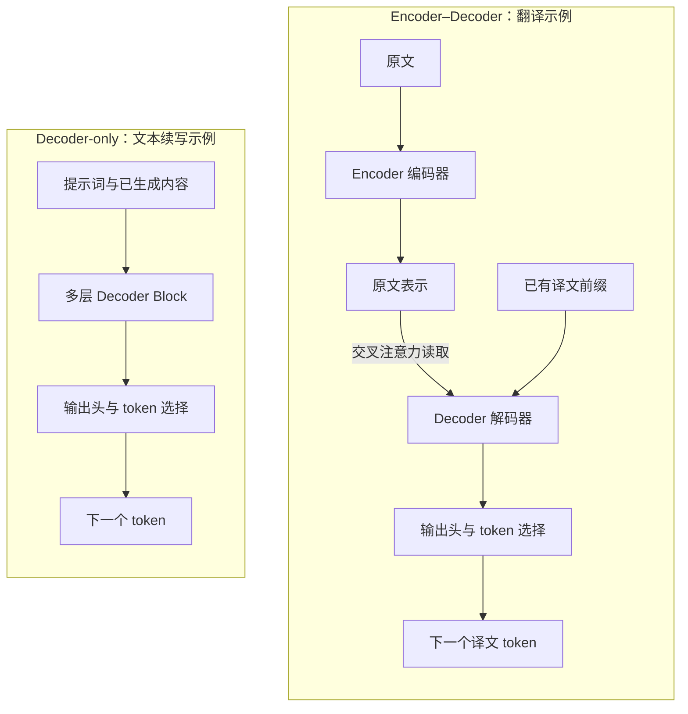
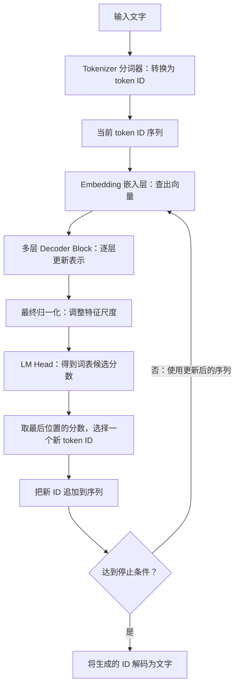
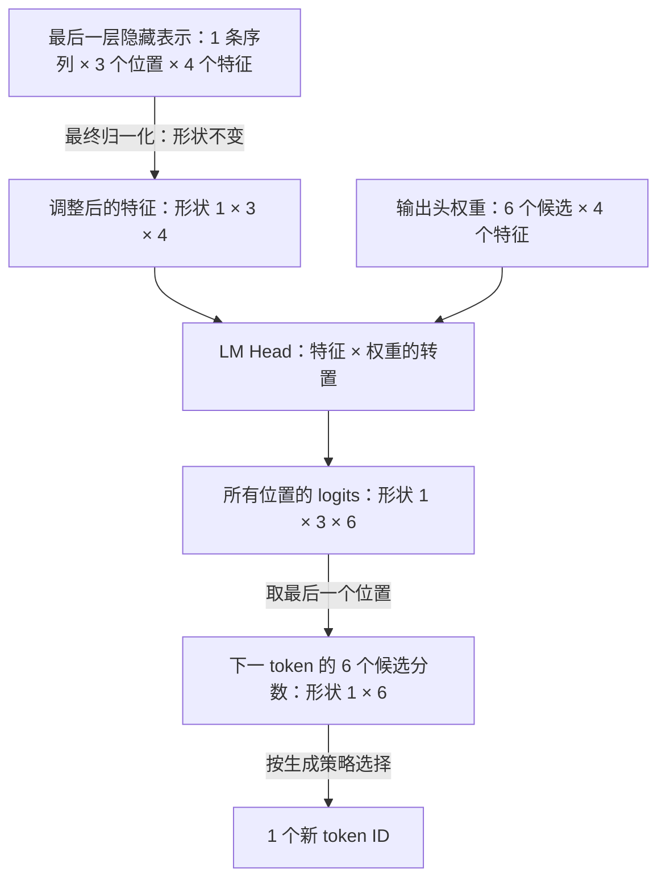

# T001 — Transformer 全局结构

## 知识讲解

**预计学习时间：20–25 分钟**

**核心问题：输入的一段文字，怎样经过模型变成下一个输出？**

承接 [B001：什么是推理](../notes/foundations/B001-what-is-inference.md)，本课打开模型这个“计算盒子”，认识里面的主要部件。

**先建立直觉：模型内部传递的是数字表示。**

可以把 Transformer 想成多道加工工序：文字先变成数字向量，每道工序结合上下文更新这些向量，最后将结果转换成候选输出的分数。“向量”在这里就是按顺序排列的一组数。

先区分两种结构：

| 结构 | 输入与输出怎样联系 |
| --- | --- |
| Encoder–Decoder（编码器—解码器） | 编码器处理原文；解码器结合原文表示和已有译文，继续生成 |
| Decoder-only（仅解码器） | 提示词和已生成内容组成同一条序列，用它预测后续内容 |

原始 Transformer 采用第一种结构。例如翻译“今天下雨”：编码器得到原文的数字表示，解码器通过**交叉注意力**读取这些表示，再结合已经生成的译文继续预测。“编码”指神经网络计算，不是加密。[原论文第 3 节](https://arxiv.org/html/1706.03762v7#S3)

许多文本生成模型采用第二种结构。以 Qwen2 文本模型为例，主体包含多层带因果注意力的 Transformer 层；**因果**表示当前位置只能利用自身及之前的位置。提示词通过这组层参与计算，无须先经过独立的编码器。[Qwen2 技术报告](https://arxiv.org/html/2407.10671v4#S2.SS2)

**图 1：两类结构，信息从哪里来？**



读图：Encoder–Decoder 中，Decoder 除了接收译文前缀，还能读取另一条路径上的原文表示；Decoder-only 的提示词与已生成内容进入同一组层。图为本课原创简图，依据上文论文；为突出区别，省略两端的分词、嵌入和归一化细节。

**沿着一次生成走一遍：**

**图 2：Decoder-only 从文字到下一 token 的完整路线。**



读图：沿主线从上往下看；选出 ID 后追加到序列，若未结束就继续计算。图为本课原创的逻辑流程，依据 [Qwen2 模型计算](https://github.com/huggingface/transformers/blob/v4.45.2/src/transformers/models/qwen2/modeling_qwen2.py)和[生成循环](https://github.com/huggingface/transformers/blob/v4.45.2/src/transformers/generation/utils.py)绘制，省略 KV Cache、位置处理和流式输出；循环箭头不代表实际实现每次都重算全部历史内容，这会在 Prefill、Decode 和缓存课展开。

**token 是模型处理的文本单位**，可能是字、词的一部分或其他片段，不固定等于一个汉字。本课只认识它在流程中的位置，具体分词方法留给 T002。

常见 Block 中，先记住各部件的分工：

| 部件 | 作用 |
| --- | --- |
| Self-Attention（自注意力） | 汇集允许访问的序列位置的信息 |
| FFN（前馈网络） | 分别变换各位置的向量 |
| 残差连接 | 将原输入与变换结果相加 |
| 归一化 | 调整数值尺度，具体位置随模型变化 |

位置的信息也会参与模型计算，本课暂不展开其实现。[结构依据](https://arxiv.org/html/1706.03762v7#S3)

**明确例子：追踪一个小模型的形状。**

以下是人为构造的教学配置：1 条序列，3 个 token，ID 为 `[1,4,2]`；每个位置用 4 个数表示，词表有 6 个候选。

| 数据 | 张量形状 |
| --- | --- |
| 输入 ID | `[1,3]` |
| 嵌入后的向量 | `[1,3,4]` |
| 每个 Block 的输出 | `[1,3,4]` |
| 所有位置的候选分数 | `[1,3,6]` |
| 最后位置的候选分数 | `[1,6]` |

**张量形状**描述数据沿各个方向的大小；`[1,3,4]` 就是“1 条序列 × 3 个位置 × 每位置 4 个数”。这里列的是模块边界，内部维度可以变化。

**形状为什么保持，又为什么变化？**

`[1,3,4]` 的三个维度分别是批大小 B（本批有 1 条序列）、序列长度 S（有 3 个 token 位置）、隐藏维度 H（每个位置用 4 个特征数表示）。这个教学模型的 Block 输入、输出都设计为 `[B,S,H]`，所以层与层之间保持 `[1,3,4]`。每层会更新其中的数值，内部计算可以临时改变维度；“多个 Block 共同计算下一个 token”描述生成流程，并不能单独解释形状保持的原因。

输出头将每个位置的 4 维特征转换成词表中 6 个候选 token 的分数。此时形状是 `[B,S,V] = [1,3,6]`，V 表示词表大小。前两个维度没有变化，最后一维的含义从“特征”变成了“各候选的分数”。普通逐步生成取最后位置的分数来选择下一个 token。

假设最后位置的六个分数是 `[0.1,0.4,-0.2,1.8,0.0,0.7]`，候选 ID 从 0 开始编号。若采用“选最高分”的策略，就选 ID `3`，序列变成 `[1,4,2,3]`。这些原始分数称为 **logits**，不直接等于概率。本例展示完整输出形状，实际实现可以只计算需要的位置。

**常见误区：**

- “有 24 层，就一次生成 24 个 token。”普通逐步生成中，各层共同计算下一个 token；层数不是输出长度。
- “中间向量变了，就是权重更新了。”本次输入产生的计算结果会变化，普通推理的权重通常保持固定。

本课的练习是画流程和认形状，为后续参考实现做准备；CPU 实现与 NPU 验证仍需分别完成。

**完整生成流程：输入与输出两端。**

以本课的 Decoder-only 为例：输入文字 → Tokenizer 转为 token ID → Embedding 转为向量 → 多层 Decoder Block → 输出归一化与 LM Head 得到词表分数 → 按生成策略选择下一个 token。每个 Block 包含自注意力、FFN、残差和归一化等计算；Self-Attention 汇集允许访问的位置的信息。

是否有独立 Encoder 由模型架构确定。原始 Encoder–Decoder 中，Encoder 处理原文，Decoder 通过交叉注意力读取编码器输出；本课的 Decoder-only 基线没有这组独立 Encoder。它不是在同一个模型的一次普通推理中可以随意省略的步骤。各模块得到向量或分数后，还需要输出选择步骤，才能确定生成的 token。

### 补充：输出归一化与 LM Head

这两个模块位于最后一个 Decoder Block 之后。以本课的教学形状为例：

**图 3：数清楚“特征数”和“候选数”。**



读图：只有输出头将最后一维从特征数 H=4 变成候选数 V=6；归一化不改变形状，选 token 后才得到一个编号。图为本课原创教学示意，展示计算所有位置输出头的情形；实现也可以只计算需要的位置。

这里的“输出归一化”指 **final normalization（最终归一化层）**。以 Transformers v4.45.2 的 Qwen2 实现为具体例子，它在所有 Decoder 层之后执行 RMSNorm，再用无偏置的线性层作为 LM Head。具体模型应以其代码和配置为准。[Qwen2 实现](https://github.com/huggingface/transformers/blob/v4.45.2/src/transformers/models/qwen2/modeling_qwen2.py)

#### 1. 输出归一化：怎样调整向量的尺度

最后一个 Block 输出的每个向量已经包含上下文信息，其各维度是训练中学到的特征，一般不能逐维解释成固定词义。最终归一化根据这个向量自身的统计量调整尺度，让送入输出头的表示尺度更可控；它也是训练时采用的模型结构的一部分，普通推理需要保留这一计算。

以 RMSNorm（均方根归一化）为例，对一个 H 维向量 `x`：

$$
r = \sqrt{\frac{1}{H}\sum_{i=1}^{H}x_i^2+\epsilon},\qquad
y_i = \frac{x_i}{r}\gamma_i
$$

操作依次是平方、求平均、加小常数、开平方、逐元素除法与缩放。`ε` 是避免分母过小的正数；`γ` 是长度为 H 的可学习缩放参数，普通推理时固定。不同输入会得到不同的 `r`，这不代表权重在更新。[RMSNorm 定义](https://docs.pytorch.org/docs/stable/generated/torch.nn.RMSNorm.html)

下面另构造一组用于手算的向量和权重，与前文假设的 logits 示例独立。只看最后一个位置，设 `x = [3,4,0,0]`。为方便手算，设 `γ = [1,1,1,1]`，暂时忽略 `ε`；实际实现必须保留数值稳定项。

```text
平方：      [9,16,0,0]
平方的均值：(9+16+0+0)/4 = 6.25
均方根：   sqrt(6.25) = 2.5
逐元素相除：[3/2.5,4/2.5,0,0] = [1.2,1.6,0,0]
乘 γ：     y = [1.2,1.6,0,0]
```

输出依旧有 4 个数，数值可以大于 1，也可以为负，所以它不是概率。对于 `[B,S,H]` 的输入，这种配置沿最后的 H 维计算：每个位置各算各的均方根，不把三个 token 混在一起求一个均方根。

另一种常见归一化是 LayerNorm：先减去该向量各维度的均值，再除以标准差（含稳定项），最后做可学习的缩放和平移。RMSNorm 不减均值，使用均方根；本课先掌握本例的计算。[LayerNorm 原论文](https://arxiv.org/abs/1607.06450)、[RMSNorm 原论文](https://arxiv.org/abs/1910.07467)

#### 2. LM Head：怎样从特征得到每个 token 的分数

LM 是 Language Model，Head 指接在模型主体后面的输出层。常见 LM Head 是一个线性层：用一组训练好的权重，把 H 个特征转换成 V 个词表分数。

采用 PyTorch 的权重排列，权重矩阵 `W` 的形状是 `[V,H]`。每行对应一个候选 token，每个分数就是该行权重与输入向量的点积，也就是“对应元素相乘后求和”：

$$
z_j=\sum_{i=1}^{H}W_{j,i}y_i+b_j,\qquad z=yW^T+b
$$

`b` 是可选的偏置；本例不使用偏置。`W^T` 表示转置，让矩阵乘法的维度匹配。`W` 和 `b`（若有）来自训练，普通推理时固定。[Linear 运算与形状](https://docs.pytorch.org/docs/main/generated/torch.nn.functional.linear.html)

继续使用 `y = [1.2,1.6,0,0]`，人为设置 6 行教学权重：

| 候选 token ID | 对应权重行 | 点积得到的分数 |
| --- | --- | --- |
| 0 | `[1,0,0,0]` | 1.2 |
| 1 | `[0,1,0,0]` | 1.6 |
| 2 | `[1,1,0,0]` | 2.8 |
| 3 | `[-1,0,0,0]` | -1.2 |
| 4 | `[0,-1,0,0]` | -1.6 |
| 5 | `[0,0,1,1]` | 0 |

例如候选 2 的分数是 `1.2×1 + 1.6×1 + 0×0 + 0×0 = 2.8`。因此得到 `logits = [1.2,1.6,2.8,-1.2,-1.6,0]`：4 个隐藏特征变成 6 个候选分数。真实模型的权重由训练学到，这张手工权重表仅用于展示乘加过程。

同一组权重应用于每个位置，整体形状由 `[B,S,H]` 变为 `[B,S,V]`。LM Head 自身不汇集其他位置的信息；它读取的隐藏表示已经由前面的 Block 融合了上下文。

#### 3. logits、softmax 与选择 token

LM Head 的原始输出叫 logits，可以有正有负，总和没有必须等于 1 的要求。需要概率分布时，可以沿词表维度执行 softmax：

$$
p_j=\frac{e^{z_j}}{\sum_{k=0}^{V-1}e^{z_k}}
$$

softmax 将候选分数转换为非负且总和为 1 的概率。本例直接应用 softmax（温度为 1、无额外筛选），得到约 `[0.1266,0.1889,0.6272,0.0115,0.0077,0.0381]`。[Softmax 定义](https://docs.pytorch.org/docs/main/generated/torch.nn.functional.softmax.html)

- 贪心选择：取分数最高的候选，本例为 token ID `2`。softmax 保持分数排序，因此这里只求 `argmax(logits)` 就足够。
- 按概率采样：按概率分布抽取，候选 2 概率最高，但不保证每次选中。

最终归一化处理隐藏特征；LM Head 产生词表分数；softmax 将词表分数变为概率。这三步的输入、输出含义不同。

#### 4. 与以后 NPU 算子的联系

从这些公式可以拆出需要实现的基础计算：RMSNorm 包含逐元素平方、沿 H 维归约求均值、倒平方根及逐元素乘法；LM Head 的核心是矩阵乘法；输出选择涉及 Argmax 或采样等操作。这只是运算拆解，尚未开展硬件验证或性能评测。此部分属于 T001 补讲，各模块的专题课程仍会分别深入。

## 自测

1. 翻译任务中的 Encoder–Decoder，解码器需要利用哪两类信息？
2. 小例子中，为什么经过多个 Block 后仍是 `[1,3,4]`，到了输出头却变成 `[1,3,6]`？各个数字代表什么？
3. 不看讲义，写出“输入文字 → 下一个 token”的主要步骤，并指出哪个部件负责汇集其他位置的信息。

反馈入口：**继续讲解 / 吃透了，归档 / 太简单，跳过**。

本组题目用于检查全局结构与形状理解，学习结果见[学习日志](../study-log/README.md)。

## 输出端巩固

**核心问题：模型已经算出了一个向量，为什么还没有得到下一个 token？**

token 是模型处理的文本单位，token ID 是它在词表中的编号。模型内部的**隐藏向量**则是一组表达当前上下文特征的数：它还不是候选 token 的分数，更不是已经选好的编号。

可以把输出端理解成三个连续动作：先调整特征尺度，再给候选打分，最后作出选择。

| 环节 | 处理什么 | 得到什么 |
| --- | --- | --- |
| 最终归一化 | 每个位置的隐藏向量 | 调整尺度后的特征，形状保持不变 |
| LM Head（语言模型输出头） | 特征与训练好的权重 | 每个词表候选的原始分数 |
| 选择步骤 | 候选分数或概率 | 下一个 token ID |

本课采用的 Qwen2 示例，在所有 Decoder Block（解码器计算模块）之后执行最终归一化，再通过线性输出头生成词表分数。这是具体实现的结构，其他模型需要分别核对。[Qwen2 实现，Transformers v4.45.2](https://github.com/huggingface/transformers/blob/v4.45.2/src/transformers/models/qwen2/modeling_qwen2.py)

**明确例子：两个特征，怎样变成三个候选分数？**

构造一个教学模型：1 条序列、2 个位置，每个位置有 2 个特征，词表有 3 个候选。**张量形状**就是各个方向上的数据数量。

如果计算所有位置的输出：

`隐藏表示 [1,2,2] → 最终归一化 [1,2,2] → 输出头 [1,2,3]`

最后一维从“两个特征”变成“三个候选的分数”，序列仍然只有两个位置。

只看最后一个位置，假设归一化后的向量是 `y = [1,2]`。给输出头设置下面三行教学权重，不使用偏置：

| 候选 ID | 权重行 | 对应元素相乘后求和 |
| --- | --- | --- |
| 0 | `[1,0]` | `1×1 + 2×0 = 1` |
| 1 | `[0,1]` | `1×0 + 2×1 = 2` |
| 2 | `[1,1]` | `1×1 + 2×1 = 3` |

得到 `logits = [1,2,3]`。**logits 是未经概率转换的候选分数**。若采用贪心选择，即直接选最高分，结果是 **ID 2**；三个分数表示三个候选，并不表示生成了三个 token。这里的向量和权重都是手工构造的，仅用于练习数据流。

如果需要概率，可以使用 **softmax（将一组分数转换成总和为 1 的概率分布）**。它与前面的最终归一化处理不同的数据：前者处理候选分数，后者处理隐藏特征。原始 Transformer 论文也将线性变换和 softmax 列为从解码器输出得到下一 token 概率的步骤。[原论文 §3.4](https://arxiv.org/html/1706.03762v7#S3.SS4)

**常见误区**

- “归一化以后就是概率。”隐藏特征仍可为负，也没有总和必须为 1 的要求。
- “输出头得到分数，就已经选好了 token。”还需要明确选择策略；最高分选择与按概率抽样是不同操作。
- “数值发生变化，说明模型又训练了。”普通推理中，中间结果随输入变化，权重通常保持固定，见[B001 笔记](../notes/foundations/B001-what-is-inference.md)。

本课只需能解释三个环节，并完成一次乘加手算。此练习属于理论巩固，不代表完成 CPU 参考实现或 NPU 设备验证。

### 巩固自测

1. 用自己的话分别说明：最终归一化、LM Head、token 选择各自产生什么结果？
2. 保持例子中的权重不变，把输入向量改成 `[2,-1]`。三个候选分数分别是多少？贪心选择哪个 ID？
3. 输出形状 `[1,2,3]` 中，哪个数字表示已有位置数，哪个表示候选数？为什么它不等于“新生成了三个 token”？

反馈入口：**继续讲解 / 吃透了，归档 / 太简单，跳过**。

本组题目用于检查输出端理解，学习结果见[学习日志](../study-log/README.md)。

## 来源

以下材料访问日期均为 **2026-10-10**：

- 主阅读：[The Illustrated Transformer](https://jalammar.github.io/illustrated-transformer/)，本课只看整体结构与编码器、解码器图解。
- 进阶选读：[Attention Is All You Need，第 3 节](https://arxiv.org/html/1706.03762v7#S3)，先看图 1，暂不推导公式。

输出端巩固部分于 **2026-10-11** 核对上述论文及正文链接的 Qwen2 固定版本实现；学习日期另记入学习日志。

图示于 **2026-10-12** 对照原论文和固定版本源码复核，见[图示核查记录](../docs/diagrams.md)。
