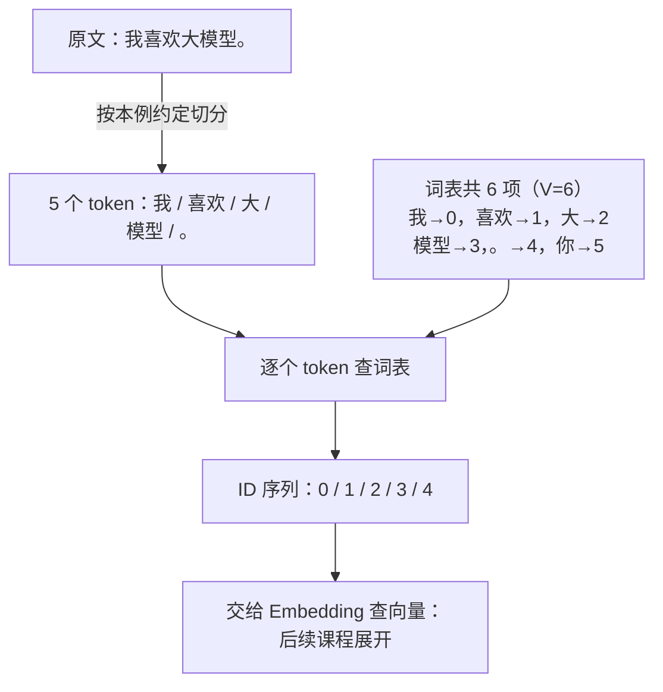
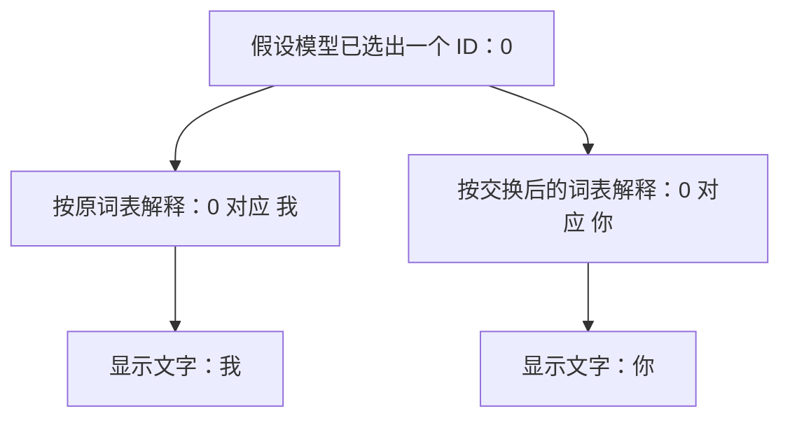

# T002-1 — Token、token ID 与词表

## 知识讲解

前置课程：[T001 — Transformer 全局结构](T001.md)。

**核心问题：输入一句话时，模型收到的整数究竟是什么？**

### 1. 先区分三个对象

| 名称 | 含义 | 本课的例子 |
| --- | --- | --- |
| token | 文本经过切分得到的处理单位 | `我`、`喜欢`、`模型` |
| token ID | 这个单位在词表中的整数编号 | `模型` 对应 `3` |
| 词表 vocabulary | 模型可用的 token 与编号之间的对应表 | 本例共有 6 项 |

Tokenizer（分词器）使用既定规则处理文字、切分并转换为 ID。token 可以对应一个字、多个字或词的一部分；不能仅靠汉字数、英文单词数判断 token 数。实际切分取决于具体 tokenizer。[Hugging Face 官方课程](https://huggingface.co/learn/llm-course/en/chapter2/4)

### 2. 用一张小词表走完整个过程

以下词表、编号和切分结果是**人为构造的教学例子**，不代表千问或 DeepSeek 的实际 tokenizer。暂不加入特殊 token。

| token ID | token |
| --- | --- |
| 0 | 我 |
| 1 | 喜欢 |
| 2 | 大 |
| 3 | 模型 |
| 4 | 。 |
| 5 | 你 |

输入文字为 `我喜欢大模型。`，本例规定切分为：

**图 1：先切分，再给每个单位查编号。**



读图：`我 / 喜欢 / 大 / 模型 / 。` 中的斜线仅表示分隔，不是输入文字。词表决定各单位的 ID，序列保留出现顺序；图为本课原创教学示例，切分由人工约定，省略特殊 token，不代表真实模型的分词结果。

这里有 7 个字符（含标点），但按本例的切分规则只有 5 个 token。词表大小 V=6，表示总共有 6 种可用单位；输入长度 S=5，表示这句话实际用了 5 个位置。两者不是一个量。

再看重复输入 `我我。`：如果切分为 `["我","我","。"]`，ID 序列就是 `[0,0,4]`。同一个 token 可以在多个位置出现，**token ID 表示身份，序列中的位置表示顺序**。

### 3. 编号的大小不表示语义强弱

`你` 的 ID 是 5，`我` 的 ID 是 0，不能据此认为前者更重要，也不能把两个 ID 的差当成语义距离。它们只是查表用的编号。

承接上一课：ID 随后交给 Embedding 查出对应的向量；LM Head 的候选索引也要与模型的词表对应。若只把词表里两个 ID 的含义交换，却保持模型权重不变，模型读入和输出的对应关系就会错位。因此应使用与模型训练时匹配的 tokenizer 和词表。[官方课程的 Encoding 说明](https://huggingface.co/learn/llm-course/en/chapter2/4#encoding)

以刚才的 5 个 token 为例，若只有 1 条序列、隐藏维度 H=4：

```text
ID 序列：             [1,5]
Embedding 后：        [1,5,4]
计算所有位置的 logits：[1,5,6]
```

这里只连接上一课的形状知识。Embedding 具体如何查表、权重怎样组织，会在 T002-4 专讲。

### 4. 一个可以直接运行的小例子

下面只演示**切分完成后的 ID 查表及反向映射**，切分结果由我们手工给出，它不是完整的分词器。

```python
vocab = {"我": 0, "喜欢": 1, "大": 2, "模型": 3, "。": 4, "你": 5}
tokens = ["我", "喜欢", "大", "模型", "。"]
ids = [vocab[token] for token in tokens]
id_to_token = {index: token for token, index in vocab.items()}
print(ids)
print("".join(id_to_token[index] for index in ids))
```

输出为 `[0, 1, 2, 3, 4]` 和 `我喜欢大模型。`。本段已用 Python 3 执行核对，无第三方依赖。实际 tokenizer 的解码可能还要处理空格、字节及特殊标记，不能一概用字符串拼接代替。[Tokenizers 官方文档](https://huggingface.co/docs/tokenizers/quicktour)

### 5. 常见误区与课程边界

- token 不固定等于一个字或一个完整单词，同一句话在不同 tokenizer 下可能有不同长度。
- token ID 不是概率、隐藏向量或出现位置；进入模型后还需要 Embedding。
- 词表大小不是每次输入的 token 数，也不是本次新生成的 token 数。
- 后续 T002-2 学习切分规则与 BPE，T002-3 学习特殊 token 和实际编码解码，T002-4 学习 Embedding。本课先掌握单位、编号和对应关系。

### 6. 词表与模型权重必须匹配

| ID | 原词表中的 token | 交换后的 token |
| --- | --- | --- |
| 0 | 我 | 你 |
| 5 | 你 | 我 |

仅修改词表、保持模型权重不变时：

- 输入端：输入“我”会被新词表编码成 ID `5`，Embedding 仍读取原来训练时与“你”对应的第 5 行向量。
- 输出端：若模型输出 ID `0`，原词表会还原为“我”，新词表却还原为“你”。这个例子只有一个 token，仍然会出错，并不涉及交换两个位置。

更准确的结论是：词表与模型权重的对应关系被破坏，输入表示和输出文字可能错配。由于输入错配会影响后续计算，实际生成也不保证只是整句中的“我”和“你”简单互换。

**图 2：保持同一个输出 ID，换词表后读到了什么？**



读图：固定同一个 ID，仅改变解释它的词表，就会显示不同文字；只有一个位置，也能出现错配。因此问题是编号对应关系，不能概括为两个位置交换。图为本课原创对照，只隔离展示输出端，不假设修改输入词表后模型仍会选出相同 ID。

## 自测

1. 沿用教学词表，把 `你喜欢模型。` 切分为 `["你","喜欢","模型","。"]`，对应的 ID 序列是什么？输入长度 S 和词表大小 V 分别是多少？
2. `你` 的 ID 是 5，`我` 的 ID 是 0，能否据此判断前者更重要或语义更强？为什么？
3. 如果仅把词表中 `我` 和 `你` 的编号交换，却保持模型权重不变，可能出现什么问题？

反馈入口：**继续讲解 / 吃透了，归档 / 太简单，跳过**。实际回答与学习状态记入[学习日志](../study-log/README.md)。

## 来源

- 主阅读：[Hugging Face — Tokenizers](https://huggingface.co/learn/llm-course/en/chapter2/4)，本课重点看词与子词的区别、Encoding 的 token 到 ID 两步过程。
- 实现边界参考：[Tokenizers Quicktour](https://huggingface.co/docs/tokenizers/quicktour)，用于核对 tokens、ids 与解码的区别；本课不要求安装依赖或训练分词器。
- 前置笔记：[T001](../notes/architecture/T001-transformer-overview.md)；[路线](../docs/roadmap.md)、[进度](../docs/progress.md)、[阅读清单](../docs/reading-list.md)。

图示于 **2026-10-12** 对照官方课程及本课教学词表复核，见[图示核查记录](../docs/diagrams.md)。
