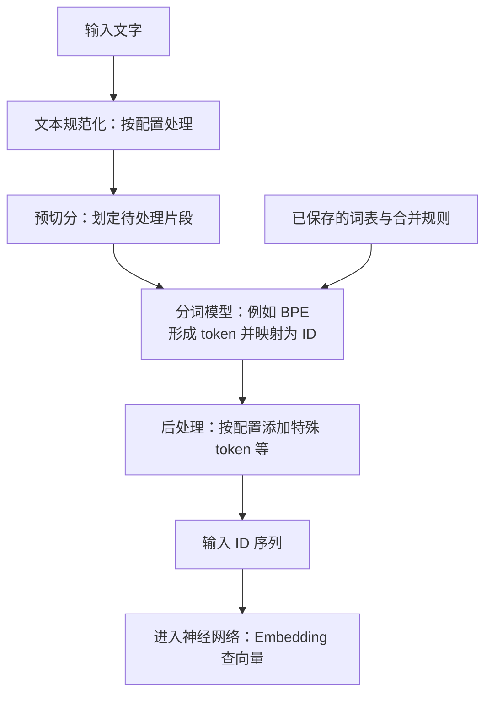
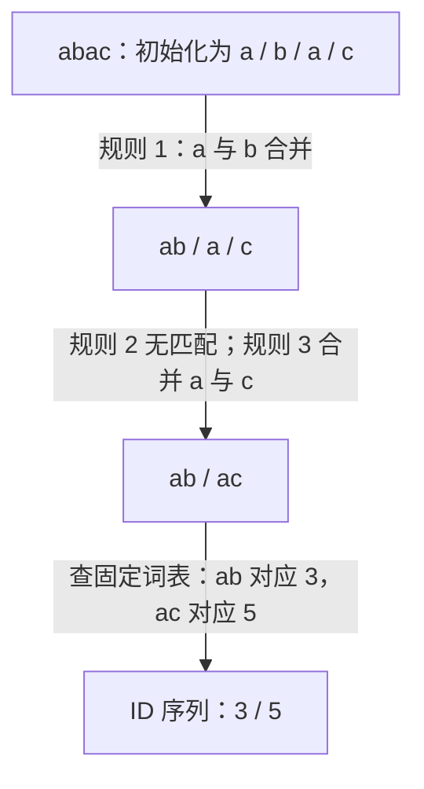

# T002-2 — Tokenizer 的处理流程与 BPE 入门

## 知识讲解

前置课程：[T002-1 — Token、token ID 与词表](T002-1.md)。预计 25–30 分钟。

**核心问题：上一课的切分由人指定，真实分词器怎样决定切成哪些 token？**

### 1. Tokenizer 不只是查词表

查表之前，要决定边界。以 Hugging Face Tokenizers 的常见处理框架为例：

**图 1：文字进入神经网络之前的处理流程。**



读图：BPE 是流程中的一个组件；图中的“分词模型”不是后面的 Transformer。规范化、预切分和后处理取决于配置，某些步骤可以不做；图省略额外输出字段及特殊 token 的具体处理。[官方流程说明](https://huggingface.co/docs/tokenizers/pipeline)

- **文本规范化**：例如按配置统一部分字符形式；不能擅自把所有输入改成小写。它处理文字，与 T001 中处理隐藏向量的 RMSNorm 不同。
- **预切分**：例如先按空格或标点划片段，再在片段内细分；不同 tokenizer 的边界规则不同，不能假设中文也靠空格分词。[规范化与预切分](https://huggingface.co/learn/llm-course/en/chapter6/4)

### 2. BPE 学习相邻片段的合并规则

BPE 是 Byte-Pair Encoding，常译为字节对编码。本课用字符作基础单位，先理解机制；字节级 BPE 的基础单位是字节，不能把所有 BPE 都理解成按汉字切分。

训练分词器时，从基础单位开始，统计语料中当前**相邻 token 对**的出现次数；选次数最多的一对合并，加入词表，再重新统计。这样得到基础单位与较长片段混合的词表，以及有先后顺序的合并规则。这里的“训练”是在学习分词规则，不是在更新 Transformer 权重。[BPE 官方课程](https://huggingface.co/learn/llm-course/en/chapter6/5)

### 3. 三轮手算：规则从哪里来

下面的语料、编号与停止条件均为**原创教学构造**。只处理字符 `a、b、c`，不做规范化，不加特殊 token；每个字符串是独立片段，不跨片段合并。初始词表是 `{a:0, b:1, c:2}`，本例达到 V=6 就停止。

| 片段 | 语料中出现次数 | 初始拆分 |
| --- | --- | --- |
| `abab` | 4 | `a / b / a / b` |
| `abac` | 2 | `a / b / a / c` |
| `ac` | 1 | `a / c` |

第一轮，`(a,b)` 在每个 `abab` 中出现两次、每个 `abac` 中一次，因此计数为 `2×4 + 1×2 = 10`。同样得到 `(b,a)=6`、`(a,c)=3`，选 `(a,b)` 合并成 `ab`。

合并后，三个片段变成 `ab / ab`、`ab / a / c`、`a / c`。下一轮统计的是这些**当前片段**，不能沿用旧计数。

| 轮次 | 当轮相邻对及加权计数 | 学到的规则 | 新增 ID |
| --- | --- | --- | --- |
| 1 | `(a,b)=10`，`(b,a)=6`，`(a,c)=3` | `a + b → ab` | `ab:3` |
| 2 | `(ab,ab)=4`，`(ab,a)=2`，`(a,c)=3` | `ab + ab → abab` | `abab:4` |
| 3 | `(ab,a)=2`，`(a,c)=3` | `a + c → ac` | `ac:5` |

没有计数并列，三轮后停止。新 token 加入词表，原有 token 保留，最终 V=6；编号只是本例约定，不代表真实 tokenizer 的编号。BPE 的统计依据是频次，不要求每个片段都有独立词义。[原论文 §3.2](https://aclanthology.org/P16-1162.pdf)

### 4. 使用时应用固定规则

训练好以后，编码新输入时使用保存的合并优先级；本课的普通确定性编码不重新统计新输入的频次，也不更新词表。

**图 2：用已经学到的三条规则编码 `abac`。**



读图：规则 2 要求两个相邻的 `ab`，这里不满足，因此没有这次合并。优先级决定应用顺序，不能看哪个片段更有意义就先合并。本例得到 2 个 token：S=2，词表仍为 V=6；如果 B=1，ID 张量形状为 `[1,2]`。图与手算例子对应，不代表真实模型的分词结果。[规则应用依据](https://huggingface.co/learn/llm-course/en/chapter6/5#tokenization-algorithm)

下面可直接运行，只实现本例单片段的三条规则，不包含训练及完整的前后处理：

```python
vocab = {"a": 0, "b": 1, "c": 2, "ab": 3, "abab": 4, "ac": 5}
merges = [("a", "b"), ("ab", "ab"), ("a", "c")]
parts = list("abac")
for left, right in merges:
    result = []
    i = 0
    while i < len(parts):
        if parts[i:i + 2] == [left, right]:
            result.append(left + right)
            i += 2
        else:
            result.append(parts[i])
            i += 1
    parts = result
print(parts)                         # ['ab', 'ac']
print([vocab[token] for token in parts])  # [3, 5]
```

本段已用 Python 3 执行核对，无第三方依赖。三轮训练计数另行复算；图示与代码使用同一套词表和规则。

### 5. 本课要守住的区别

- 训练分词器学习词表与规则；使用分词器按已有配置编码。输入重复很多次，不会自动重新训练它。
- token ID 与合并优先级不是同一个概念；本例编号与新增顺序相邻只是教学安排。
- BPE 不是所有 tokenizer 的统称。真实部署要保留模型配套的算法、词表、规则和配置，不能自行换成这份小词表。
- 后处理与特殊 token 留给 T002-3，Embedding 留给 T002-4；本课只追踪文字到 ID。

## 自测

1. 本课语料的第一轮为什么先合并 `(a,b)`？请写出它的计数过程；合并以后，下一轮能继续使用第一轮的旧计数吗？
2. 使用已经训练好的三条规则和最终词表，编码新片段 `ababac`。写出每轮片段、最终 ID 序列，以及 S 和 V。
3. 如果新输入中 `ac` 出现了 100 次，普通编码会不会因此把 `a + c → ac` 改成第一条规则？这与训练分词器有什么区别？

反馈入口：**继续讲解 / 吃透了，归档 / 太简单，跳过**。实际回答与学习状态记入[学习日志](../study-log/README.md)。

## 来源

核对日期：**2026-10-13**。例子与图示为原创教学构造；核查结果见[图示记录](../docs/diagrams.md)。

- 主阅读：[Hugging Face：Byte-Pair Encoding tokenization](https://huggingface.co/learn/llm-course/en/chapter6/5)，重点看 Training algorithm 与 Tokenization algorithm。
- 流程核对：[Tokenizers pipeline](https://huggingface.co/docs/tokenizers/pipeline)、[Normalization and pre-tokenization](https://huggingface.co/learn/llm-course/en/chapter6/4)。
- 进阶选读：[Sennrich 等，2016，§3.2](https://aclanthology.org/P16-1162.pdf)，本课不要求阅读实验部分；教学例省略论文中的词尾标记。
