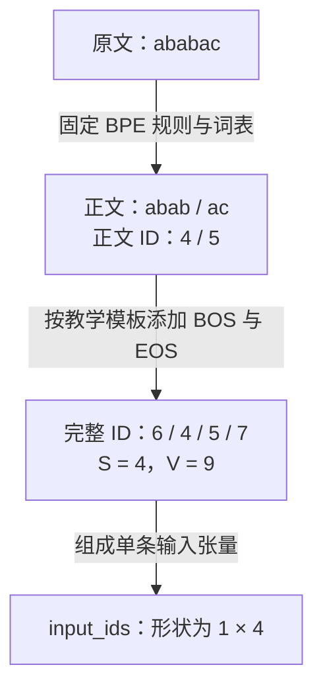
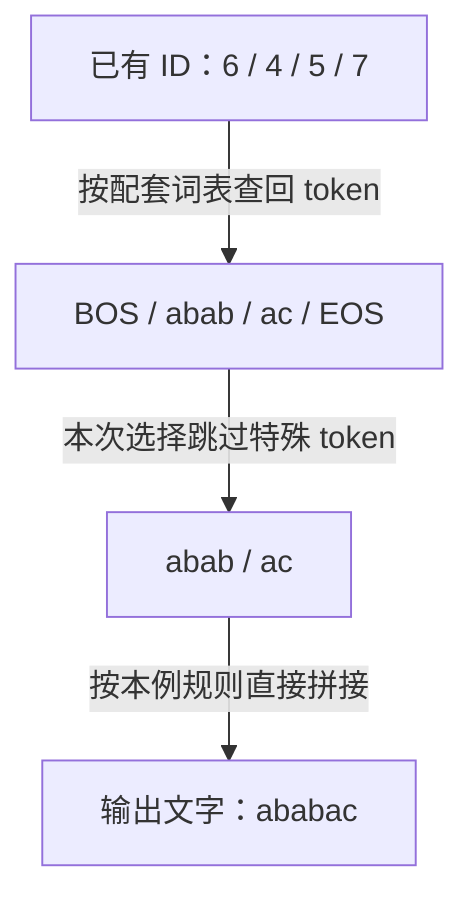

# T002-3 — 特殊 token、模型配套与文本解码

## 知识讲解

前置课程：[T002-2 — Tokenizer 的处理流程与 BPE 入门](T002-2.md)。预计 20–30 分钟。

**核心问题：分好词之后，怎样把边界信息交给模型，又怎样把 ID 正确变回文字？**

### 1. 特殊 token 也有 ID

普通 token 主要表示文本片段；特殊 token 用于约定边界、填充或其他结构信息。它们同样占用编号，进入输入序列时也占一个位置。

| 名称 | 直观作用 | 需要区分的地方 |
| --- | --- | --- |
| BOS（Beginning of Sequence） | 标记序列开始 | 不是每种模型都要求添加 |
| EOS（End of Sequence） | 标记序列结束 | 不等于句号；生成时是否据此停止，由生成配置和停止逻辑决定 |
| PAD（Padding） | 将不同长度的序列补齐，便于批处理 | 不表示正文，需要配套掩码等处理，不能只插入编号就认为模型会自动忽略 |

实际名称、ID、添加位置都由模型配置决定；不同用途也可能复用同一个 ID，不能照抄另一模型的设置。[特殊 token 定义](https://huggingface.co/docs/transformers/main/en/main_classes/tokenizer) · [生成与停止配置](https://huggingface.co/docs/transformers/v4.45.2/en/main_classes/text_generation)

### 2. 给上一课的例子加上边界

本课使用**另行预设好的教学词表**：沿用原来的六项，再预留三项。它从本例开始就是 V=9，不是在每次编码时扩充词表。

```text
a:0  b:1  c:2  ab:3  abab:4  ac:5
<bos>:6  <eos>:7  <pad>:8
```

BPE 规则仍依次为 `a+b→ab`、`ab+ab→abab`、`a+c→ac`。教学模板规定：单个完整片段在句首加 BOS、句尾加 EOS；不做文本规范化。

**图 1：普通片段编码后，按模板添加边界。**



读图：边界 token 不需要从 `ababac` 的字母里合并出来；它们由模板加入。这里只演示单片段后处理，不表示所有聊天提示都要在末尾加 EOS。[后处理原理](https://huggingface.co/docs/tokenizers/pipeline#post-processing)

完整序列为 `[6,4,5,7]`，所以 S=4；词表 V=9，即使 PAD 没有出现在这次输入中，它仍是词表的一项。若为了展示填充，在右侧再放两个 PAD，得到 `[6,4,5,7,8,8]`，张量位置数变为 6，有效的非 PAD 位置仍为 4，V 不变。相应的简单输入掩码为 `[1,1,1,1,0,0]`。

这里的右填充只用于计数示意，不是自回归生成的通用配置建议；真实批量生成须遵循引擎的填充方向与掩码约定，掩码细节后续学习。

### 3. 分词器为什么必须与模型配套

模型看到的是 ID，权重中相应位置的含义来自训练时的约定。两个 tokenizer 即使 V 一样，只要 ID 与 token 的对应不同，就可能把同一编号解释成不同内容；预切分、合并规则不同，也会改变输入序列。[官方课程的配套要求](https://huggingface.co/learn/llm-course/en/chapter2/4#encoding)

部署时使用目标模型发布的 tokenizer 与对应版本，同时核对特殊 token、聊天模板和生成配置。聊天模板负责把“谁在说话、说了什么”组织为模型熟悉的序列；不意味着每个角色名称本身都是单个特殊 token。

模板通常已包含所需的边界标记。若先用 `apply_chat_template(..., tokenize=False)` 得到文本，再单独分词，官方建议设置 `add_special_tokens=False`，避免重复添加。实际使用时按模型模板处理，不手工猜格式。[聊天模板说明](https://huggingface.co/docs/transformers/main/en/chat_templating)

### 4. tokenizer.decode 是把已有 ID 变成文字

它读取 ID 对应的 token，再按该 tokenizer 的解码规则重建字符串。对于本课字符片段，拼接就够了；实际实现还可能处理子词标记、空格和字节。[文本解码原理](https://huggingface.co/docs/tokenizers/pipeline#decoding)

**图 2：同一条教学序列的文本解码，不执行模型生成。**



读图：这里的输入 ID 已经存在，可以来自原文编码，也可以来自模型生成。跳过特殊 token 只影响显示结果，不会撤销模型计算或代替生成停止判断。[`decode` 参数](https://huggingface.co/docs/transformers/main/en/main_classes/tokenizer#transformers.PreTrainedTokenizer.decode)

“特殊”指配置中登记为特殊 token 的标记，不是字符看起来特殊；普通标点不会仅因 `skip_special_tokens=True` 就被删除。

最小演示只实现本课词表查回与拼接，可用 Python 3 直接运行：

```python
id_to_token = ["a", "b", "c", "ab", "abab", "ac", "<bos>", "<eos>", "<pad>"]
special_ids = {6, 7, 8}

def decode_toy(ids, skip_special_tokens=False):
    return "".join(
        id_to_token[i] for i in ids
        if not (skip_special_tokens and i in special_ids)
    )

ids = [6, 4, 5, 7]
print(decode_toy(ids))        # <bos>ababac<eos>
print(decode_toy(ids, True))  # ababac
```

这不是完整 tokenizer，也不调用 Transformer。真实 tokenizer 不保证 `decode(encode(text))` 逐字恢复原文：例如编码时若按配置转成小写，原有大小写信息就丢失了；未知 token 替代、空白处理也可能影响还原。是否无损要检查具体配置。[规范化与解码说明](https://huggingface.co/docs/tokenizers/pipeline)

### 5. 三个名字相近的概念

| 概念 | 做什么 | 后续学习位置 |
| --- | --- | --- |
| `tokenizer.decode` | 已有 ID → 可读文字 | 本课 |
| 模型的 Decode 阶段 | 用模型计算并逐步生成新 token | I002 |
| Decoder Block | 模型内部更新隐藏向量的计算模块 | T004–T009 |

常见误区：特殊 token 一律不算 S；显示时跳过 EOS 就不会停止；V 相同即可换分词器；把 ID 转文字等同于运行模型。以上均不成立。Embedding 如何按 ID 查出向量留给 T002-4。

## 自测

1. 沿用本课词表和“句首加 BOS、句尾加 EOS”的教学模板，编码 `abac`。写出完整 ID 序列、S 和 V；若再在右侧补一个 PAD，S 和 V 分别变为多少？
2. 两个 tokenizer 的词表大小都是 9，是否就能在同一模型上互换？至少指出两项需要一致的内容。
3. `tokenizer.decode(ids, skip_special_tokens=True)` 会重新运行 Transformer 来预测下一个 token 吗？它能保证逐字恢复输入原文吗？各说明原因。

反馈入口：**继续讲解 / 吃透了，归档 / 太简单，跳过**。实际回答与学习状态记入[学习日志](../study-log/README.md)。

## 来源

核对日期：**2026-10-13**。词表、模板、代码和图示均为原创教学构造，不对应某个真实模型的 token 编号；核查记录见[图示说明](../docs/diagrams.md)。

- 主阅读：[Hugging Face：Tokenizers](https://huggingface.co/learn/llm-course/en/chapter2/4)，重点看 Encoding 与 Decoding。
- 进阶选读：[Chat templates](https://huggingface.co/docs/transformers/main/en/chat_templating)，重点看模板配套与重复添加特殊 token。
- 定义核对：[Tokenizer API](https://huggingface.co/docs/transformers/main/en/main_classes/tokenizer)、[Tokenizers pipeline](https://huggingface.co/docs/tokenizers/pipeline)。API 文档为本次查看的 main 版本，不据此假设所有已安装版本接口一致。
- 停止逻辑核对：[Transformers v4.45.2 Generation](https://huggingface.co/docs/transformers/v4.45.2/en/main_classes/text_generation)，区分生成控制与文本解码。
