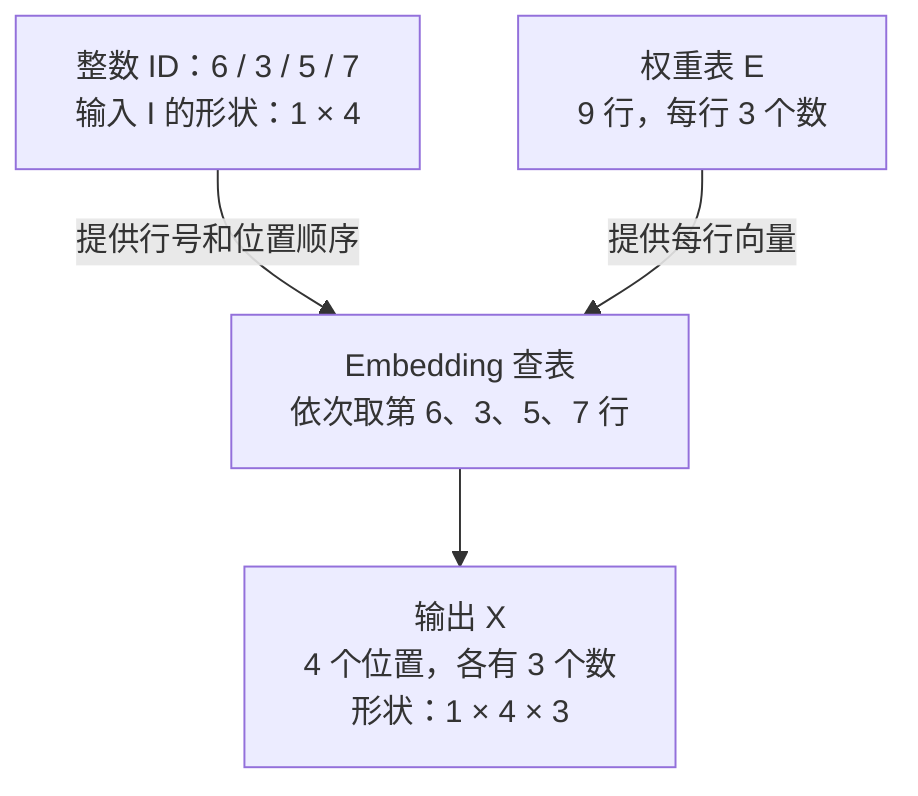

# T002-4 — Embedding 查表、权重与形状

## 知识讲解

前置课程：[T002-3 — 特殊 token、模型配套与文本解码](T002-3.md)。预计 20–30 分钟。

**核心问题：Tokenizer 输出的整数 ID，怎样变成模型计算使用的向量？**

### 1. ID 指定行号，Embedding 读取这一行

把 Embedding（嵌入）想成一张数值表：每行对应一个 token，每行存 H 个数。输入 ID 为 3，就读取行号 3 的向量；行号从 0 开始。ID 只是索引，不会被直接当成“语义大小”，也不是把数字 3 重复 H 次。

记这张权重表为 E，其形状为 `[V,H]`：V 是表中可查的行数，本课等于词表大小；H 是每行向量的长度。实际模型可能为对齐预留额外行，部署时要核对模型配置；本课不考虑这类额外行。[Embedding 定义与形状](https://docs.pytorch.org/docs/2.14/generated/torch.nn.Embedding.html)

### 2. 沿用词表，新增一张教学权重表

继续使用上一课的九个 token，设 H=3。下面的 E 是**手工构造的演示数据**，不是从真实模型提取的，也不赋予各列人为语义标签。

| ID / 行号 | token | E 的这一行 |
| --- | --- | --- |
| 0 | `a` | `[0.1,0.0,0.2]` |
| 1 | `b` | `[0.0,0.3,0.1]` |
| 2 | `c` | `[-0.2,0.1,0.0]` |
| 3 | `ab` | `[1.0,2.0,0.0]` |
| 4 | `abab` | `[0.0,1.0,3.0]` |
| 5 | `ac` | `[2.0,0.0,1.0]` |
| 6 | `<bos>` | `[-1.0,0.0,1.0]` |
| 7 | `<eos>` | `[0.0,-1.0,1.0]` |
| 8 | `<pad>` | `[0.0,0.0,0.0]` |

上一课的 `abac` 加上教学边界后，单条输入是 `[[6,3,5,7]]`。依次读取 E 的第 6、3、5、7 行，得到：

```text
输入 ID：[[6, 3, 5, 7]]

输出 X：[[[-1.0,  0.0, 1.0],   # ID 6
          [ 1.0,  2.0, 0.0],   # ID 3
          [ 2.0,  0.0, 1.0],   # ID 5
          [ 0.0, -1.0, 1.0]]]  # ID 7
```

一行 ID 序列中的每个位置变成一个向量，位置顺序保持不变；不会把四个位置相加成一个向量。

### 3. 追踪 B、S、V、H

B 表示批次里的序列条数，S 表示每条输入的张量位置数，包含已添加的特殊 token 和填充位置。本例 B=1、S=4、V=9、H=3。

| 数据 | 通用形状 | 本例形状 | 内容 |
| --- | --- | --- | --- |
| 输入 I | `[B,S]` | `[1,4]` | 整数 ID |
| 权重 E | `[V,H]` | `[9,3]` | 固定的向量表 |
| 输出 X | `[B,S,H]` | `[1,4,3]` | 每个输入位置查到的向量 |

公式只表达“按 ID 取整行”：

$$
X[b,s,:] = E[I[b,s],:]
$$

其中 `:` 表示取这一行的全部 H 个数。E 有 `V×H=27` 个标量；本次 X 有 `B×S×H=12` 个标量，两者不是同一份数据的形状。[官方输入输出约定](https://docs.pytorch.org/docs/2.14/generated/torch.nn.Embedding.html)

**图 1：输入 ID 和权重表共同决定 Embedding 输出。**



读图：V 决定可以查哪些行，S 决定这次要输出多少个位置，H 决定每个位置输出多长的向量。这里只画 token Embedding，省略后续各层、位置处理与缓存；范围对应普通固定权重查表。[Qwen2 固定版本源码](https://github.com/huggingface/transformers/blob/v4.45.2/src/transformers/models/qwen2/modeling_qwen2.py)中，`embed_tokens(input_ids)` 的结果随后交给模型层。

若这条输入再补一个 PAD，输入变为 `[1,5]`，输出变为 `[1,5,3]`；E 仍为 `[9,3]`。PAD 即使查到零向量，也仍占一个位置。零向量仅是本例约定，不替代后续注意力掩码，也不能认定所有模型的 PAD 向量都是零。

### 4. 表里的数从哪里来

Embedding 表通常是模型的可学习参数：训练时，误差通过反向传播影响参数，优化器更新这些数；某些训练方式会冻结它。使用训练好的模型做普通推理时，读取模型权重文件中的表，不是每次收到 ID 都重新随机生成向量。

向量可以学习对任务有用的特征，但不能默认“第一维表示性别、第二维表示重要性”。本课中的简单整数只是为了方便查表。[PyTorch 官方教程](https://docs.pytorch.org/tutorials/beginner/nlp/word_embeddings_tutorial.html)

在固定 E、只做本课查表的条件下，同一个 ID 出现两次，就取同一行，初始向量相同。随后的位置处理和 Self-Attention 等会引入位置、上下文信息，不能据此认为两处最终隐藏向量也必然相同。[Qwen2 的嵌入与后续层](https://github.com/huggingface/transformers/blob/v4.45.2/src/transformers/models/qwen2/modeling_qwen2.py)

### 5. 最小查表代码

以下代码用 Python 3 列表演示本课 `[B,S] → [B,S,H]`，不依赖深度学习框架：

```python
E = [
    [0.1, 0.0, 0.2], [0.0, 0.3, 0.1], [-0.2, 0.1, 0.0],
    [1.0, 2.0, 0.0], [0.0, 1.0, 3.0], [2.0, 0.0, 1.0],
    [-1.0, 0.0, 1.0], [0.0, -1.0, 1.0], [0.0, 0.0, 0.0],
]
input_ids = [[6, 3, 5, 7]]
assert all(0 <= i < len(E) for row in input_ids for i in row)
X = [[E[i][:] for i in row] for row in input_ids]
print(X)
print(len(X), len(X[0]), len(X[0][0]))  # 1 4 3
```

这里复制行内容是为了避免 Python 列表之间的修改互相影响；不代表设备实现必须这样复制。例子仅覆盖非空、等长的二维 ID 输入，不实现梯度、量化、分布式或 `max_norm` 等选项。后续做算子时，要验证索引范围、取行内容、顺序、数据类型和输出布局；本课不作设备性能结论。

### 6. 与前后模块的分工

Tokenizer 负责文字与 ID 的转换；Embedding 负责 ID → 初始向量；后续模型层更新向量；LM Head 将隐藏向量映射为候选分数。Embedding 查表不会直接给出下一个 token 的概率，也不等同于 `tokenizer.decode`。这条分工沿用 [T001](T001.md)，下一课 T003 再系统学习张量形状、矩阵乘法与广播。

## 自测

1. 使用本课权重表 E，对已经给定的输入 `[[5,3,5]]` 做 Embedding 查表，不再添加特殊 token。依次写出三个位置的向量，以及输出形状。
2. 设 B=2、每条输入填充后 S=5、V=9、H=3，分别写出输入 ID、权重 E、输出 X 的形状。若每条输入再补一个 PAD，这三个形状分别如何变化？
3. 固定权重且只做本课的查表时，同一个 ID 在两个不同位置出现，得到的向量是否相同？经过后续模型层后还能保证相同吗？说明原因，并指出普通推理时是否需要重新训练这张表。

反馈入口：**继续讲解 / 吃透了，归档 / 太简单，跳过**。实际作答与状态写入[学习日志](../study-log/README.md)。

## 来源

核对日期：**2026-10-13**。教学词表沿用 T002-3，权重数值与图为原创构造；图与例子的核查见[图示记录](../docs/diagrams.md)。

- 主阅读：[PyTorch：Word Embeddings](https://docs.pytorch.org/tutorials/beginner/nlp/word_embeddings_tutorial.html)，阅读可学习表示与查表部分即可，不要求完成文末训练练习。
- 定义核对：[PyTorch 2.14：Embedding](https://docs.pytorch.org/docs/2.14/generated/torch.nn.Embedding.html)，重点看 weight 与 Shape；本课使用固定权重，不启用会改写权重的 `max_norm`。
- 进阶选读：[Transformers v4.45.2 Qwen2 源码](https://github.com/huggingface/transformers/blob/v4.45.2/src/transformers/models/qwen2/modeling_qwen2.py)，只定位 `embed_tokens` 的构造与调用；不代表已学习或运行整个模型。
