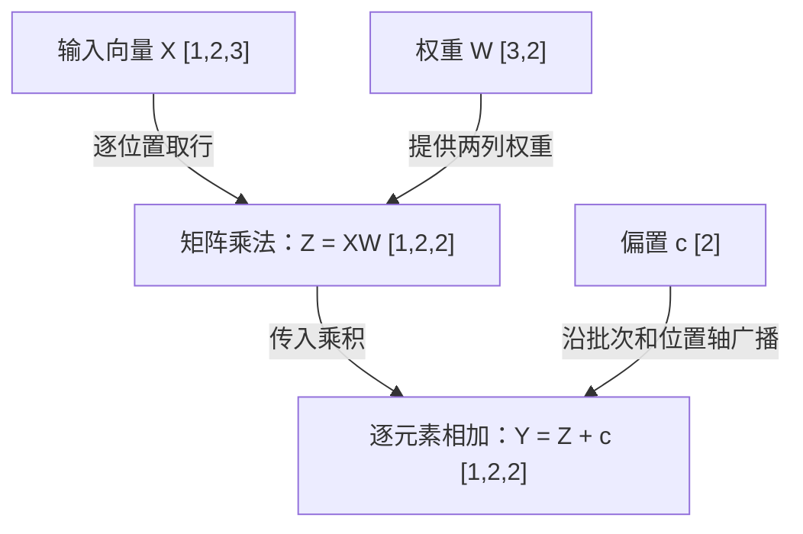

# T003 — 张量形状、矩阵乘法与广播

前置知识：[T002-4：Embedding 查表、权重与形状](T002-4.md)，知道每个 token 位置可以对应一个向量。

核心问题：输入为 `[B,S,H]` 时，怎样判断线性投影能否计算、输出是什么形状，以及偏置加到了哪里？

## 知识讲解

### 1. 直观作用：给每个位置换一组特征

Embedding 提供初始向量，后续模型需要把这些数按不同权重组合。**线性投影**就是把每个位置的 H 个输入特征，组合成 D 个输出特征。这里的位置数保持不变；仅做这种投影时，不同位置之间不交换信息。

在本课中，**张量**可以理解为按多个轴组织的数值数组，**形状**记录各轴的长度。单个数叫标量，一列数叫向量，按行列排列的二维数组叫矩阵。

| 符号 | 含义 |
| --- | --- |
| B | 批次大小，即一起处理的序列条数 |
| S | 每条序列在张量中的位置数 |
| H | 每个位置的输入特征数 |
| D | 每个位置的输出特征数 |

`[1,2,3]` 表示三个轴：1 条序列、2 个位置、每个位置 3 个数，总共 6 个数。它与只有两个轴的 `[2,3]` 不同，即使二者元素总数相同。

### 2. 明确例子：一行输入分别遇到两列权重

采用手工配置 `B=1、S=2、H=3、D=2`。沿用前课出现过的两个向量，新增一张教学权重矩阵 W：

```text
X[0] = [[1, 2, 0],       W = [[1, 0],
        [2, 0, 1]]            [0, 1],
                              [1, 1]]
```

`X[0]` 表示取出第 0 条序列，其形状为 `[2,3]`；完整 X 的形状为 `[1,2,3]`。

矩阵乘法的一个输出数，来自“左边的一行”和“右边的一列”：对应相乘，再全部相加。这叫**点积**。

第一行 `[1,2,0]` 与 W 的两列分别计算：

- 第一列：`1×1 + 2×0 + 0×1 = 1`。
- 第二列：`1×0 + 2×1 + 0×1 = 2`。

第二行同理得到 `[3,1]`，所以乘积 `Z[0]=[[1,2],[3,1]]`。每个位置仍有自己的输出行，只是每行从 3 个数变成了 2 个数。

### 3. 公式与形状：相乘要求中间维匹配

二维矩阵的规则是：

```text
[M,K] @ [K,N] → [M,N]
```

两个 K 必须相同，因为点积中的数需要一一配对。M、N 保留，K 在求和后消失。

对于本课的三维输入，最后两个轴执行矩阵乘法，各批次使用同一个 W：

```text
X [B,S,H] @ W [H,D] → Z [B,S,D]
```

更一般的批量矩阵乘法，还会检查前面的批次轴能否广播；**矩阵相乘的内维 H 仍须相等**。[PyTorch matmul 规则](https://docs.pytorch.org/docs/2.14/generated/torch.matmul.html)

再加入**偏置** c，即每个输出特征附加的一个参数，得到：

$$
Y_{b,s,d}=\sum_{h=0}^{H-1}X_{b,s,h}W_{h,d}+c_d
$$

这里小写的 b、s、h、d 是索引，从 0 开始；求和符号表示把 H 项累加。带偏置时严格说是仿射变换，框架通常仍称它为线性层。

### 4. 广播：同一组偏置供多个位置使用

令 `c=[10,-1]`，就对 Z 的每一行都加这两个数：

```text
[1,2] + [10,-1] = [11,1]
[3,1] + [10,-1] = [13,0]
```

**广播**是不同形状参与逐元素运算时的对齐规则：从最右边开始，各轴长度必须相等，或其中一个为 1；缺少的左侧轴按 1 处理。

```text
乘积 Z： [B,S,D]
偏置 c： [    D]  → 按 [1,1,D] 对齐
输出 Y： [B,S,D]
```

因此，每个批次、每个位置复用相同的 `c[d]`。广播不要求先把偏置实际复制成很多份，输出本身仍包含全部结果元素。[官方广播规则](https://docs.pytorch.org/docs/2.14/notes/broadcasting.html)

**图 1：线性投影与偏置的数据流**



读图：X 和 W 共同计算 Z，随后 c 加到每个输出位置。图中数据都是数值特征或参数，不是 token ID、概率或新生成的 token。

这是上述教学配置的通用线性层示意，不绑定特定模型版本，省略注意力、激活和缓存。箭头及形状依据上述官方规则核对；已使用 Mermaid CLI 在 Chrome 中渲染并查看，中文标签、箭头和形状完整，见[核查记录](../docs/diagrams.md)。

### 5. 最小参考代码

下面用 Python 3 列表显式展开计算，无需第三方库。`sum` 完成点积的累加，外面两层循环保留批次和位置。

```python
X = [[[1, 2, 0], [2, 0, 1]]]
W = [[1, 0], [0, 1], [1, 1]]
c = [10, -1]
Y = []
for sequence in X:
    output_sequence = []
    for x in sequence:
        row = []
        for d in range(2):
            value = sum(x[h] * W[h][d] for h in range(3))
            row.append(value + c[d])
        output_sequence.append(row)
    Y.append(output_sequence)
print(Y)
# [[[11, 1], [13, 0]]]
```

完整输出形状为 `[1,2,2]`。上述代码已执行，结果与手算一致；它演示偏置复用的含义，不是通用广播库，也不代表整模型或设备验证。

### 6. 常见误区

- **把矩阵乘法当成逐元素乘法。** 在 PyTorch 张量中，`@` 做矩阵乘法，`*` 做逐元素乘法，后者不会自动累加特征。
- **认为广播能修复任何不匹配。** 例如长度 3 和 4 都不为 1，就不能在同一轴上广播。
- **只看元素总数，不看轴的含义。** 交换位置轴和特征轴会改变数据对应关系。
- **忽略权重存储方向。** 本课 W 是 `[H,D]`；PyTorch `Linear(H,D)` 的 `weight` 存为 `[D,H]`，计算时使用其转置，即交换行列后的矩阵。[Linear 定义](https://docs.pytorch.org/docs/2.14/generated/torch.nn.Linear.html)

## 自测

1. 给定 `X:[2,4,3]`、`W:[3,5]`、`c:[5]`，写出 `X@W+c` 的形状和元素总数，并说明每条序列的位置数是否变化。如果 W 改为 `[4,5]`，还能相乘吗？说明原因。
2. 使用正文的 W 和 c，将一个位置的输入改为 `[2,-1,3]`。分别写出矩阵乘法后的两个数，以及加偏置后的两个数，并列出点积算式。
3. 给定 `Z:[2,3,4]`，分别判断 `[4]`、`[3,1]`、`[2,4]` 能否与 Z 广播相加，说明对齐过程。若想为两个批次分别提供一个长度为 4、在该批次全部位置复用的偏置向量，应把偏置组织成什么三维形状？

反馈入口：**继续讲解 / 吃透了，归档 / 太简单，跳过**。可按原题号作答，或指出需要拆解的步骤。[当前进度](../docs/progress.md)

## 来源

核对日期：2026-10-14；2026-10-15 复核官方计算规则、数值例子及自测形状，并完成图示预览。

- 主阅读：从[阅读清单](../docs/reading-list.md)选择 Sebastian Raschka《LLMs from Scratch》，本课只读[附录 A 的 A.2 张量部分](https://github.com/rasbt/LLMs-from-scratch/blob/main/appendix-A/01_main-chapter-code/code-part1.ipynb)，关注形状、转置和矩阵乘法；已打开原始笔记本核对。
- 事实与图示依据：上文链接的 PyTorch 2.14 `matmul`、广播语义和 `Linear` 官方文档。
- 示例、图和自测为原创教学材料；正文数值及自测计算已用 Python 标准库复算，形状按规则逐项核对。
