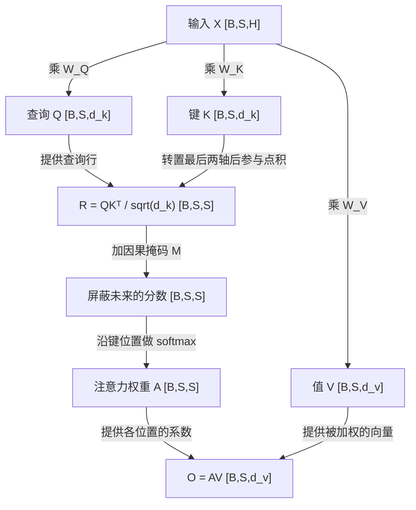

# T004 — Self-Attention 与 Q/K/V

前置知识：[T003：张量形状、矩阵乘法与广播](T003.md)。本课直接使用矩阵乘法，不重复基础点积练习。

核心问题：**同一条序列里的每个位置，怎样根据内容汇集其他可见位置的信息？**

## 知识讲解

### 1. 从逐位置投影到跨位置汇集

`XW` 在每个位置内部组合特征；Self-Attention（自注意力）则让一个位置根据匹配程度，汇集同一序列中可见位置的向量。“Self”表示 Q、K、V 来自同一组输入，不是只看自己。

本课只研究单头、因果注意力的核心计算：一次输入完整的 S 个位置，不含填充和 KV Cache；省略位置编码、投影偏置、dropout、输出投影、残差与归一化。因此这里的输出 O 还不是完整 Decoder Block 的输出。

### 2. Q、K、V 是同一输入的三种投影

设输入 `X:[B,S,H]`，B 是批次，S 是位置数，H 是输入特征数：

```math
\begin{aligned}
Q &= X W_Q \\
K &= X W_K \\
V &= X W_V
\end{aligned}
```

同一计算的纯文本写法（`@` 表示矩阵乘法）：

```text
Q = X @ W_Q
K = X @ W_K
V = X @ W_V
```

| 名称 | 作用 | 权重形状 | 结果形状 |
| --- | --- | --- | --- |
| Q：Query，查询 | 当前位置用什么特征去匹配 | `[H,d_k]` | `[B,S,d_k]` |
| K：Key，键 | 各位置拿什么特征参与匹配 | `[H,d_k]` | `[B,S,d_k]` |
| V：Value，值 | 各位置实际提供哪些特征 | `[H,d_v]` | `[B,S,d_v]` |

`d_k` 是 Q/K 的向量长度，必须一致才能做点积；`d_v` 是 V 的向量长度，可以不同。这里的 V 是值张量，不是之前用于表示词表大小的符号。

三张 W 是训练得到、普通推理时固定的参数；Q/K/V 是输入经过计算产生的中间张量，会随输入变化。来自同一个 X 不表示三者数值相同。初层输入与 Embedding 有关，更深层接收前面模块更新后的表示。[作者参考实现](https://github.com/rasbt/LLMs-from-scratch/blob/main/ch03/01_main-chapter-code/ch03.ipynb)

### 3. 匹配、归一化权重、加权汇集

先算位置之间的匹配分数，再把分数转成权重，最后汇集 V：

```math
\begin{aligned}
R &= \frac{Q K^{\mathsf{T}}}{\sqrt{d_k}} \\
A &= \mathrm{softmax}(R + M) \\
O &= A V
\end{aligned}
```

同一计算的纯文本写法：

```text
K_T = transpose(K, -2, -1)
R   = (Q @ K_T) / sqrt(d_k)
A   = softmax(R + M, dim=-1)
O   = A @ V
```

`transpose(K, -2, -1)` 表示交换 K 最后两个轴，`sqrt` 表示平方根，`dim=-1` 表示沿最后一维（键位置）计算 softmax。以上是计算记法，不是可直接调用的完整代码；可运行示例见第 5 节。

这里的转置只交换 K 最后两个轴。`R[b,i,j]` 表示第 i 个查询与第 j 个键的缩放点积；除以 `sqrt(d_k)` 用来控制点积的尺度。因果掩码 M 在 `j≤i` 时为 0，未来位置 `j>i` 为负无穷，因此当前位置能看自己和过去。[原论文 §3.2](https://arxiv.org/html/1706.03762v7#S3.SS2)

softmax 对**每一行的键位置**处理：把允许位置的分数取指数后除以指数总和，得到非负、和为 1 的权重；被屏蔽位置的权重为 0。掩码和 softmax 的细节在 T005 深入。

```text
Q [B,S,d_k] @ Kᵀ [B,d_k,S] → 分数 [B,S,S]
A [B,S,S]   @ V  [B,S,d_v] → 输出 [B,S,d_v]
```

分数矩阵的行是“谁在查询”，列是“从哪个位置取信息”。第二次矩阵乘法沿键位置求和：`O[b,i,:] = Σ_j A[b,i,j] V[b,j,:]`。这一步才把不同位置的值汇集到一起；S 个输入位置仍得到 S 个输出向量。

**图 1：单头因果注意力的数据流**



读图：Q/K 决定汇集的系数，V 提供被汇集的内容；两条路径在 O 处汇合。M 是按因果规则构造的 `[S,S]` 矩阵，在批次间共享；图采用本节简化范围，不展示完整模型或实际内存分配。[官方计算顺序](https://docs.pytorch.org/docs/2.14/generated/torch.nn.functional.scaled_dot_product_attention.html)

图已渲染并检查中文标签、箭头、形状与计算顺序，数值例子另行复算，见[核查记录](../docs/diagrams.md)。

### 4. 三个位置的完整小例子

取 `B=1、S=3、H=d_k=d_v=2`，下表省略批次轴；所有数字均为手工教学配置，不赋予向量维度固定语义。

```text
X   = [[1,0], [0,1], [1,1]]
W_Q = [[1,0], [0,1]]
W_K = [[1,1], [0,1]]
W_V = [[1,0], [0,2]]

Q = [[1,0], [0,1], [1,1]]
K = [[1,1], [0,1], [1,2]]
V = [[1,0], [0,2], [1,2]]
```

第三个位置的 `q=[1,1]` 与三行 K 点积，得到 `[2,1,3]`；缩放后约为 `[1.4142,0.7071,2.1213]`。它能看到全部三个位置，softmax 得到约 `[0.2840,0.1400,0.5760]`，于是：

```text
o = 0.2840×[1,0] + 0.1400×[0,2] + 0.5760×[1,2]
  ≈ [0.8600,1.4320]
```

输出是一条新特征向量；注意力权重对应三个**输入位置**，不是三个候选 token 的生成概率，也不在这一步选择下一个 token。

### 5. 最小参考代码

Python 3 标准库即可运行。为便于阅读只实现单个批次，完整输出再包一层得到 `[1,3,2]`；不是通用张量库。

```python
from math import exp, sqrt

def matmul(a, b):
    columns = list(zip(*b))
    return [[sum(x * y for x, y in zip(row, col))
             for col in columns] for row in a]

X = [[1, 0], [0, 1], [1, 1]]
WQ = [[1, 0], [0, 1]]
WK = [[1, 1], [0, 1]]
WV = [[1, 0], [0, 2]]
Q, K, V = [matmul(X, w) for w in (WQ, WK, WV)]
R = matmul(Q, list(zip(*K)))
A = []
for i, row in enumerate(R):
    scores = [value / sqrt(len(Q[0])) if j <= i else -float("inf")
              for j, value in enumerate(row)]
    maximum = max(scores)
    exponents = [exp(value - maximum) for value in scores]
    A.append([value / sum(exponents) for value in exponents])
O = matmul(A, V)
print([[round(value, 6) for value in row] for row in O])
# [[1.0, 0.0], [0.5, 1.0], [0.859971, 1.432009]]
```

减去行最大值不改变 softmax 结果，有助于数值稳定。本例每行至少能看自己，没有全被屏蔽的行；也没有 dropout。参考实现用于理解计算，不能据此推断实际 NPU 的执行方式或性能。

### 6. 需要辨清的边界

- **Q/K/V 与 W 不同**：前者是本次输入的计算结果，后者是模型参数。
- **形状相同不等于含义相同**：即使 `d_k=d_v`，用 `AK` 替代 `AV` 也改变了被汇集的数据。
- **注意力权重与词表概率不同**：A 沿键位置归一化；LM Head 的候选分数沿词表组织。
- **单头输出不是整层输出**：后续还要学习多头与输出投影等；这里的 `[B,S,S]` 是逻辑分数形状，不意味着所有优化实现都必须完整存储它。

## 自测

1. 给定 `X:[2,4,6]`、`W_Q/W_K:[6,3]`、`W_V:[6,5]`，写出 Q、K、V、K 转置最后两轴后、`QKᵀ` 和 O 的形状。`QKᵀ` 最后两个轴分别代表什么？输出的位置数是否变化？
2. 另一个三位置的单头因果注意力算例中，第二个位置的 `q=[1,0]`，三行 K 为 `[[1,0],[1,0],[9,9]]`，三行 V 为 `[[2,0],[0,4],[100,100]]`，`d_k=2`。写出三个未缩放的点积分数，说明哪个位置被屏蔽；利用“相等分数得到相等权重”，写出该行 A 和输出向量。为什么第三个位置的高分不能影响这个输出？
3. 把输出写成 `AK` 是否总会产生形状错误？即使 `d_k=d_v`，为什么它仍不等于原来的计算？另外，在本课配置下保持参数不变，只修改第三个位置的输入，第一、第二个位置的输出会改变吗？说明依据。

反馈入口：**继续讲解 / 吃透了，归档 / 太简单，跳过**。交互自测以这里的原题与题号为准；补充练习另行标注。[当前进度](../docs/progress.md)

## 来源

核对日期：2026-10-15。例子、图和自测为原创教学材料。

- 主阅读：[Sebastian Raschka《LLMs from Scratch》第 3 章代码](https://github.com/rasbt/LLMs-from-scratch/blob/main/ch03/01_main-chapter-code/ch03.ipynb)，聚焦 `SelfAttention_v1` 和 `CausalAttention`；已读取原始 notebook 核对投影、缩放与掩码顺序。
- 公式依据：[Attention Is All You Need §3.2](https://arxiv.org/html/1706.03762v7#S3.SS2)，关注缩放点积、V 的加权和及因果限制。
- 实现规则：[PyTorch 2.14 SDPA](https://docs.pytorch.org/docs/2.14/generated/torch.nn.functional.scaled_dot_product_attention.html)，本课使用默认缩放与无 dropout 的因果计算。
- 例子计算、图示内容与显示检查分别记录在[核查记录](../docs/diagrams.md)，不作为学习者完成实践的证据。
